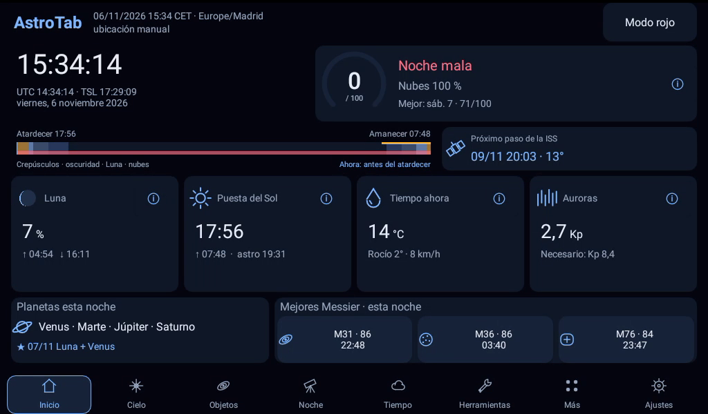
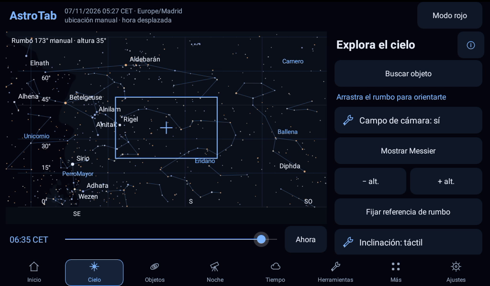
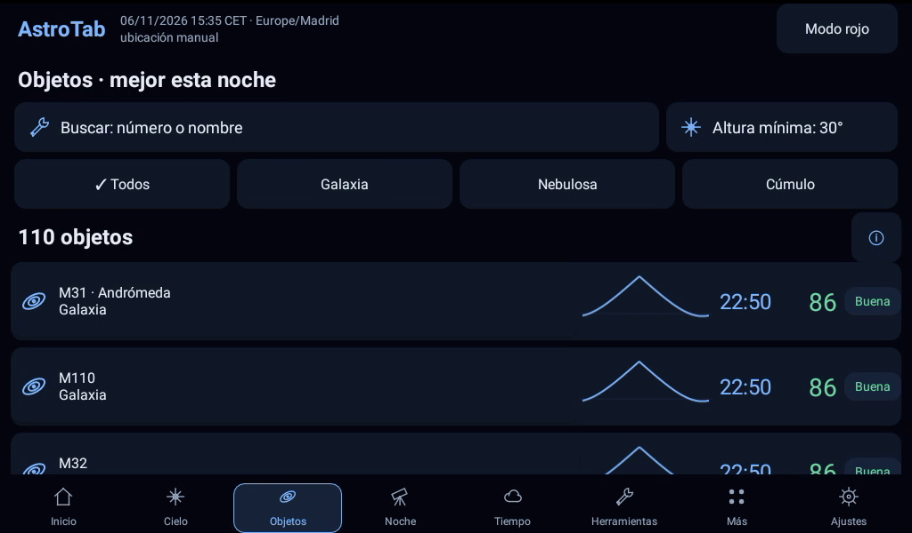
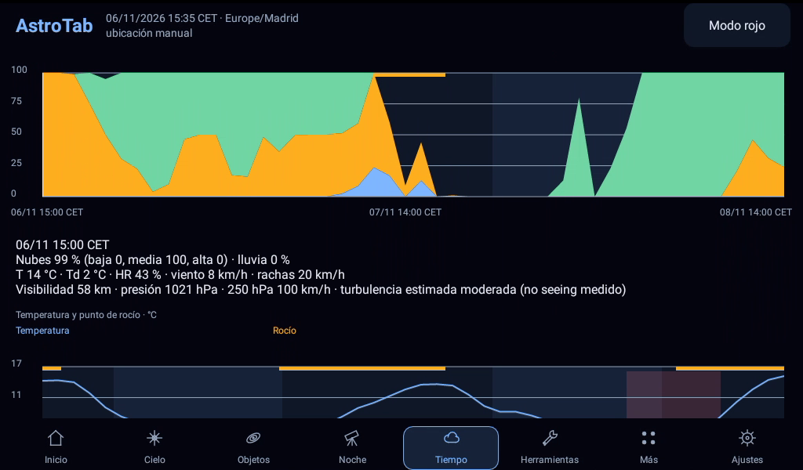
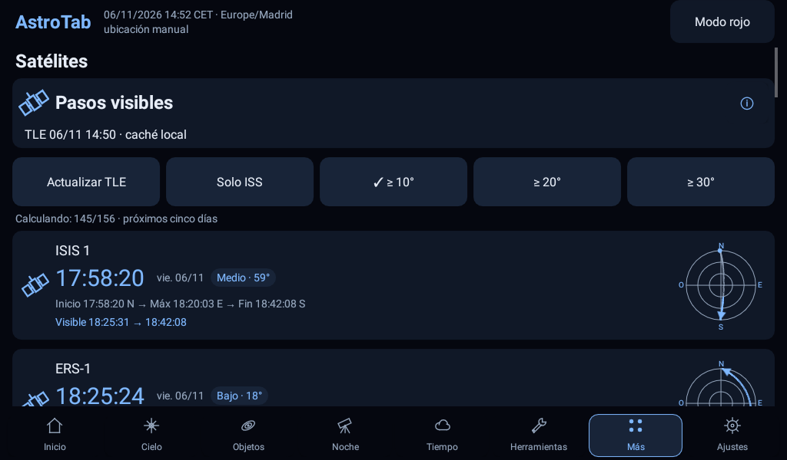
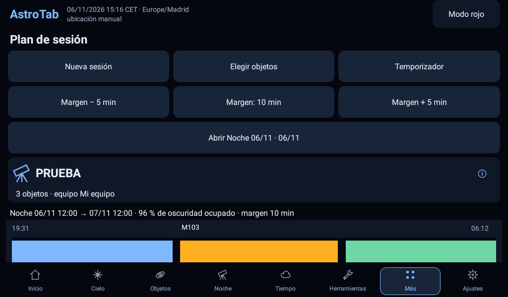
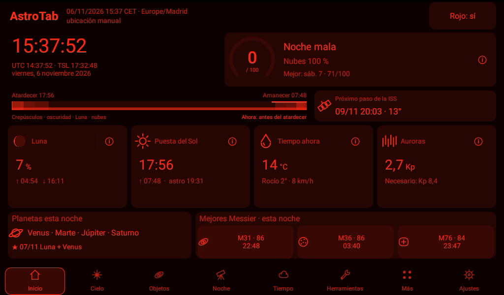

# AstroTab 0.7.2

**Una tablet vieja que iba a la basura, con una vida nueva: asistente de astrofotografía y fotografía nocturna.**

Proyecto abierto y **no comercial de MS Robotika**, sin publicidad, cuentas ni compras. Restablece una tablet Android antigua, deja AstroTab como pantalla de inicio y tendrás un panel para preparar y acompañar tus noches de foto, con astronomía y catálogos disponibles sin conexión.



## Qué hace

- **Inicio:** relojes, resumen de la noche, Sol, Luna, planetas y accesos a objetivos.
- **Cielo:** mapa con estrellas, constelaciones, Vía Láctea, búsqueda y encuadre de cámara; rumbo manual e inclinación opcional.
- **Objetos y planificador:** 110 Messier, fichas, ventanas de observación y plan de sesión con integración y avisos de meridiano.
- **Tiempo:** próximas 48 horas y comparación de siete noches con Open-Meteo; nubes, temperatura, rocío, viento y lluvia.
- **Auroras:** Kp observado y previsto de NOAA SWPC. **Satélites:** propagación SGP4, TLE opcionales de CelesTrak, pasos visibles y acceso al cielo.
- **Eventos y Luna:** eclipses, lluvias de meteoros aproximadas, fases, salidas, puestas y calendario lunar.
- **Herramientas de foto:** reglas 500/NPF, encuadre, reloj polar, Vía Láctea, timelapse, hiperfocal, mosaico y apilado; sesión manual con temporizador, bitácora exportable, alarmas y perfiles de equipos.
- **Modo rojo** global y linterna roja; opción de pantalla de inicio y kiosco.

El temporizador acompaña una sesión manual: no dispara ni controla la cámara. Cámara automática y control Bluetooth son propuestas futuras, descritas en [ROADMAP](docs/ROADMAP.md).

## Capturas

Capturas reales de la pantalla de una Alcatel Pixi 4 7" (Android 6) con AstroTab 0.7.1.








## iPhone y iPad (versión web)

Abre **https://msrobotika.github.io/AstroTab/** en Safari y pulsa **Compartir → Añadir a pantalla de inicio**: se instala con su icono, a pantalla completa y funciona sin conexión. Tiene las mismas pestañas y funciones que la app de Android (Inicio, Cielo, Objetos, Noche, Tiempo, Foto, Más y Ajustes), con un cielo tipo planetario (vista al horizonte, zoom con dos dedos y modo «apuntar con el móvil»): noche y nota de la noche, mapa del cielo con búsqueda, encuadre de cámara y brújula, 110 Messier con ficha y plan de sesión, 48 h y 7 noches de tiempo, satélites (SGP4 en el dispositivo), auroras (Kp de NOAA), eventos, meteoros y calendario lunar, reloj polar, Vía Láctea, hiperfocal, timelapse, mosaico, apilado, sesión con temporizador, bitácora exportable, alarmas, perfiles de equipo, linterna roja y modo rojo.

Límites de iOS: las alarmas y el temporizador suenan solo con la app abierta, y no hay modo kiosco ni pantalla de inicio. La lógica de `core/` está traducida a JavaScript en [`web/pro.js`](web/pro.js); SGP4 usa [satellite.js](https://github.com/shashwatak/satellite-js) 5.0.0 (MIT) en [`web/vendor/`](web/vendor/). Pruebas: `node web/test/astro.test.js` y `node web/test/pro.test.js`.

## Requisitos

Android **6.0 o posterior** (API 23), pantalla preferentemente horizontal. Probado en una **Alcatel Pixi 4 7 pulgadas, modelo 8063, con 1 GB de RAM** (unos 30 MB de memoria en uso). El modo rojo nocturno en el campo, el sensor de inclinación y las alarmas con la tablet en reposo aún no se han probado de noche.

Desde la 0.7.2, AstroTab se muestra encima de la pantalla de bloqueo, que en Android 6 no gira: al encender la tablet aparece directamente en horizontal. Un bloqueo por deslizamiento desaparece; un PIN sigue protegiendo todo lo que no sea AstroTab.

No necesita Google Play Services, brújula ni GPS. Introduce la ubicación manualmente en Ajustes y revisa fecha, hora y zona horaria. Sin ubicación guardada, la app no inventa una. El acelerómetro es opcional y solo ayuda con la inclinación; el rumbo se ajusta a mano.

## Instalación

Descarga el APK desde **[Releases](../../releases)** y permite su instalación desde esa fuente en Android. Es una compilación de depuración firmada con clave de desarrollo: para actualizar a otra firma habrá que desinstalar antes.

También puedes instalar tu compilación con Android Platform Tools y una tablet autorizada:

```sh
adb install -r app/build/outputs/apk/debug/app-debug.apk
```

Este comando es una instrucción para el usuario, no un paso de compilación. Conserva el APK y su clave si necesitas actualizar una instalación; una firma distinta exige desinstalar y puede perder los datos. Exporta antes la bitácora y cualquier información que quieras conservar.

## Compilar y probar

Necesitas **JDK 17**, Android SDK Platform **36** y Build Tools **36.0.0**, instalados por tu cuenta. Configura `JAVA_HOME` y `ANDROID_HOME` para tu instalación; alternativamente indica `sdk.dir` en un `local.properties` privado e ignorado. El proyecto no descarga componentes del SDK automáticamente.

Desde la raíz, en Windows:

```powershell
.\gradlew.bat testDebugUnitTest lintDebug assembleDebug
```

En Linux/macOS, con las mismas variables configuradas:

```sh
./gradlew testDebugUnitTest lintDebug assembleDebug
```

El wrapper fija Gradle 8.14.3; AGP 8.11.0 y Kotlin 2.1.20 están fijados en el proyecto. La primera compilación necesita acceso a las distribuciones de Gradle y los repositorios Gradle/Maven. Robolectric descarga sus SDK de prueba mediante Gradle. Con cachés completas puedes añadir `--offline`.

APK de depuración: `app/build/outputs/apk/debug/app-debug.apk`. Informes: `app/build/reports/` y `core/build/reports/`. Las capturas sintéticas de pruebas quedan en `app/build/screens/`, fuera del control de versiones. La clave debug se genera localmente en `.gradle/` y nunca se versiona; para distribuir una versión estable utiliza una clave propia. La verificación de esta copia se recoge en [Spec Kit 010](specs/010-public-release/verification.md).

## Pantalla de inicio y kiosco opcional

Puedes elegir AstroTab como aplicación de inicio en el selector HOME de Android, cuando el sistema lo permita. Como app normal puedes cambiar de launcher desde los ajustes del sistema.

El kiosco administrado usa Device Owner, PIN y lock task. **Es opcional y difícil de revertir: retirar Device Owner puede requerir un restablecimiento de fábrica y borrar los datos.** Lee y prueba la salida y la recuperación de [docs/KIOSCO.md](docs/KIOSCO.md) antes de activarlo. No es necesario para las funciones astronómicas.

## Privacidad y conexión

La **red está desactivada por defecto**. No hay telemetría ni cuentas. La ubicación, equipos, preferencias y bitácora se guardan localmente. Las exportaciones pueden contener ubicación y notas: revísalas antes de compartirlas.

Al activar la red o solicitar una consulta, los destinatarios son:

| Servicio | Datos enviados y finalidad |
| --- | --- |
| Open-Meteo (`api.open-meteo.com`) | Latitud y longitud guardadas, variables meteorológicas solicitadas y parámetros de previsión. Recibe también la IP de la conexión. |
| NOAA SWPC (`services.swpc.noaa.gov`) | Solicitudes de índices Kp observados y previstos; recibe la IP, sin enviar coordenadas. |
| CelesTrak (`celestrak.org`) | Solicitudes de TLE para ISS y grupo visual; recibe la IP y la selección de catálogo, sin enviar coordenadas. La predicción local se calcula en la tablet. |
| ipapi.co | Solo al pedir explícitamente ubicación aproximada por IP en Ajustes. Recibe la IP y devuelve una estimación de ubicación. No es necesario para usar la app. |

Los proveedores ven los metadatos habituales de una conexión HTTPS. Los eclipses NASA se incluyen como tabla offline y no se consultan desde la app. Apagar la red impide nuevas consultas; una petición ya iniciada puede terminar. Los datos llevan fecha y se cachean; la interfaz distingue ausencias y datos antiguos. La bitácora no almacena fotografías y no se sube a ningún servidor.

## Precisión y límites

AstroTab ayuda a planificar; sus cálculos aproximados no sirven para guiar monturas ni sustituyen una efeméride de precisión. Las estrellas del mapa son J2000 sin precesión; Messier y referencias de herramientas aplican precesión media. No se modelan todos los efectos atmosféricos ni el horizonte del terreno. Los campos amplios y las alturas extremas pueden deformar el encuadre visual.

La corriente en chorro y la nota de noche son **estimaciones heurísticas: no hay seeing medido**. El Kp no es una probabilidad de ver auroras; los TLE envejecen y no permiten deducir una magnitud fiable. Las fechas de meteoros son aproximadas. La altura del Sol durante un eclipse no demuestra visibilidad local ni totalidad. Las reglas 500/NPF, SNR y restantes calculadoras dependen de supuestos y del equipo.

El temporizador no continúa si se mata el proceso. El comportamiento de alarmas, brillo, sensores, HOME y kiosco depende del dispositivo; las pruebas simuladas no garantizan su funcionamiento físico. Los objetivos de rendimiento y memoria pendientes constan en el ROADMAP.

## Licencias y créditos

Código propio: **MIT, MS Robotika**, texto en [LICENSE](LICENSE). El proyecto y su uso de servicios se plantean como no comerciales; esto no añade restricciones a la licencia MIT. Quien adapte la aplicación debe respetar también las condiciones de los datos y servicios que utilice.

- **d3-celestial, Olaf Frohn:** estrellas, constelaciones, Messier y Vía Láctea, licencia **BSD-3-Clause**.
- **AstroCYD MS / MS Robotika:** base de cálculos astronómicos; método de Paul Schlyter y referencias de Jean Meeus.
- **Open-Meteo:** datos **CC BY 4.0**, API gratuita de uso no comercial.
- **NOAA SWPC:** datos públicos de dominio público, con atribución; no respalda AstroTab.
- **CelesTrak** y **Vallado, Crawford, Hujsak, Kelso / Gano:** fuentes de TLE y referencia SGP4; procedencia y condiciones en los avisos.
- **NASA/GSFC, Fred Espenak:** tablas numéricas de eclipses de dominio público. **IMO:** referencias climatológicas de meteoros.

Los textos completos, condiciones, certificados públicos y dependencias se detallan en [THIRD_PARTY_NOTICES.md](THIRD_PARTY_NOTICES.md) y en Acerca de dentro de la app. Las fuentes y marcas no respaldan el proyecto.

Para colaborar, consulta [CONTRIBUTING.md](CONTRIBUTING.md). No publiques diagnósticos sin revisar sus datos personales.

## English summary

AstroTab gives old Android tablets a second life as an astrophotography planning assistant. It is an open, non-commercial MS Robotika project for Android 6.0+, with offline sky maps, 110 Messier objects, session planning, Moon and photo calculators, optional weather, aurora and satellite data, and a global red mode. No Google Play Services, compass or GPS are required. Networking is off by default; manual location is supported. Own code is MIT; third-party data retain their licenses. Calculations and forecasts are approximate, not measured seeing or mount guidance. Build with JDK 17 and Android SDK 36 using the Gradle wrapper. Optional Device Owner kiosk mode can be difficult to reverse: read the Spanish recovery guide before enabling it.
